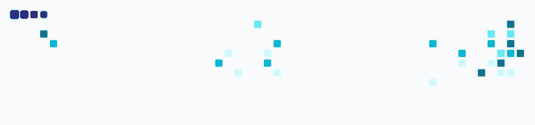

<!--
  Douglas Morais | GitHub Profile README
  Portfolio: https://douglasmorais-arq.vercel.app/
  Repository: github.com/mrdouglasmorais
-->

<div align="center">

<a href="https://douglasmorais-arq.vercel.app/" target="_blank">
  
</a>

<br/>

<a href="https://douglasmorais-arq.vercel.app/" target="_blank">
  
</a>
<a href="https://www.linkedin.com/in/douglasmoraissouza/" target="_blank">
  
</a>
<a href="mailto:mr.douglasmorais23@gmail.com">
  
</a>
<a href="https://github.com/mrdouglasmorais?tab=repositories">
  
</a>

<br/><br/>

[](https://douglasmorais-arq.vercel.app/)
[](https://github.com/mrdouglasmorais)

</div>

---

> [!TIP]
> **The proof is in the code.** Hiring teams can audit it. I work as a specialist consultant and solutions architect for companies that need resilient systems, scalable architecture and AI that actually runs in production without hallucinating business rules. See my full work at **[douglasmorais-arq.vercel.app](https://douglasmorais-arq.vercel.app/)** or let's talk on **[LinkedIn](https://www.linkedin.com/in/douglasmoraissouza/)**.

---

## 🏆 Recognition, Certifications & Badges

Official badges and academic and industry certifications earned along the way:

### 🎓 Harvard, Stanford & Linux Foundation

<table align="center" width="100%">
  <tr align="center">
    <td width="20%" valign="top">
      <a href="https://douglasmorais-arq.vercel.app/certificates/courses/CS50x.pdf" target="_blank">
        <br/>
        <sub><b>Harvard University</b><br/>CS50x Computer Science</sub>
      </a>
    </td>
    <td width="20%" valign="top">
      <br/>
      <sub><b>Stanford University</b><br/>CS193p Developing Applications for iOS</sub>
    </td>
    <td width="20%" valign="top">
      <a href="https://douglasmorais-arq.vercel.app/certificates/courses/LFD121.pdf" target="_blank">
        <br/>
        <sub><b>Linux Foundation</b><br/>LFD121 Developing Secure Software</sub>
      </a>
    </td>
    <td width="20%" valign="top">
      <br/>
      <sub><b>Linux Foundation</b><br/>LFEL1006 Securing Projects with OpenSSF Scorecard</sub>
    </td>
    <td width="20%" valign="top">
      <a href="https://douglasmorais-arq.vercel.app/certificates/courses/LFEL1008.pdf" target="_blank">
        <br/>
        <sub><b>Linux Foundation</b><br/>LFEL1008 Migrating AI Workflows Across Platforms</sub>
      </a>
    </td>
  </tr>
  <tr align="center">
    <td width="20%" valign="top">
      <a href="https://douglasmorais-arq.vercel.app/certificates/courses/LFS140.pdf" target="_blank">
        <br/>
        <sub><b>Linux Foundation</b><br/>LFS140 Feature Flagging (OpenFeature)</sub>
      </a>
    </td>
    <td width="20%" valign="top">
      <a href="https://douglasmorais-arq.vercel.app/certificates/courses/LFS144.pdf" target="_blank">
        <br/>
        <sub><b>Linux Foundation</b><br/>LFS144 Introduction to Istio Service Mesh</sub>
      </a>
    </td>
    <td width="20%" valign="top">
      <a href="https://douglasmorais-arq.vercel.app/certificates/courses/LFS148.pdf" target="_blank">
        <br/>
        <sub><b>Linux Foundation</b><br/>LFS148 Getting Started with OpenTelemetry</sub>
      </a>
    </td>
    <td width="20%" valign="top">
      <a href="https://douglasmorais-arq.vercel.app/certificates/courses/LFS158.pdf" target="_blank">
        <br/>
        <sub><b>Linux Foundation</b><br/>LFS158 Introduction to Kubernetes</sub>
      </a>
    </td>
  </tr>
</table>

### 🎖️ Awards & Press

<table align="center" width="70%">
  <tr align="center">
    <td width="50%" valign="top">
      <a href="https://douglasmorais-arq.vercel.app/certificates/awards/50_to_Follow_2022_HACKER.pdf" target="_blank">
        <br/>
        <sub><b>Gama Academy — Award</b><br/>50 to Follow 2022 · Hacker category</sub>
      </a>
    </td>
    <td width="50%" valign="top">
      <a href="https://douglasmorais-arq.vercel.app/certificates/press/sucesso-sa.pdf" target="_blank">
        <br/>
        <sub><b>Sucesso SA — Press</b><br/>Entrepreneurship, Leadership & Business</sub>
      </a>
    </td>
  </tr>
</table>

---

## 🧭 From problem to user

Four steps. One system that is operable, resilient and scalable:

```
┌────────────────────────────┐     ┌────────────────────────────┐     ┌────────────────────────────┐     ┌────────────────────────────┐
│        01. PROBLEM         │ ──▶ │      02. ARCHITECTURE      │ ──▶ │        03. PLATFORM        │ ──▶ │       04. EXPERIENCE       │
│       What must work       │     │   Services, data, limits   │     │  AWS, delivery, telemetry  │     │  The screen or the agent   │
└────────────────────────────┘     └────────────────────────────┘     └────────────────────────────┘     └────────────────────────────┘
```

| Step | Decision focus | Delivered value |
|---|---|---|
| **01. Problem** | Business domain, business requirements and technical trade-offs | Clarity before the first line of code |
| **02. Architecture** | Clean Architecture, DDD, boundary isolation, idempotency and messaging | Decoupled systems that tolerate failure |
| **03. Platform** | AWS cloud, Kubernetes (EKS), serverless, Terraform and observability | Infrastructure as code with FinOps and telemetry |
| **04. Experience** | Reactive interfaces (Next.js/React), mobile (Flutter) or autonomous agents (MCP) | The delivery edge — visual or orchestrated by AI |

---

## 🧠 Where AI fits: the model doesn't hold the system. The architecture does.

> Probabilistic language-model calls must stay **completely isolated** from deterministic business rules. That is how AI creates real value without putting financial, tax or domain compliance at risk.

```text
┌────────────────────────────────────────────────────────────┐
│                User / Client / Web / Mobile                │
└───────────────────────────────┬────────────────────────────┘
                                │
                                ▼
┌────────────────────────────────────────────────────────────┐
│                    API / Domain Gateway                    │
│         Deterministic business rules, auth & RBAC          │
└───────────────────────────────┬────────────────────────────┘
                                │
                                ▼
┌────────────────────────────────────────────────────────────┐
│                   AI Orchestration Layer                   │
│         Telemetry context · Guardrails · MCP tools         │
└───────────────┬─────────────────────────────┬──────────────┘
                │                             │
                ▼                             ▼
┌──────────────────────────┐      ┌──────────────────────────┐
│    Knowledge & Search    │      │      LLM Providers       │
│     RAG · Embeddings     │      │  Writes only at the end  │
└──────────────────────────┘      └──────────────────────────┘
```

- **Beyond RAG:** Evidence, versioning and permission control. An answer is only released when the system shows where it came from.
- **SignalGate & Telemetry:** Telemetry becomes operational context. Jev decides the route and validates the evidence; the code executes. AI never presses the button blindly.
- **Agents in production:** Embeddings and vector search find the exact context. Specialist agent routing with strict latency and token-cost control. The LLM writes only at the end.

---

## 🛠️ Technology Stack & Engineering Arsenal

<div align="center">

### Languages, Frameworks & Frontend


### Cloud, Infrastructure, DevOps & Data


</div>

| Layer | Technologies & Patterns |
|---|---|
| **Architecture & Engineering** | Clean Architecture, Domain-Driven Design (DDD), CQRS, Event-Driven, Microservices, C4 Model |
| **Backend & APIs** | Java, C# .NET 9, Node.js, TypeScript, Python, GraphQL, REST APIs, gRPC, Outbox Pattern |
| **Cloud & DevOps (AWS)** | AWS Lambda, ECS / Fargate, EKS (Kubernetes), EventBridge, S3, Terraform, CI/CD Actions |
| **Artificial Intelligence** | Model Context Protocol (MCP), Amazon Bedrock, RAG, Embeddings, Multi-Agent Systems, Guardrails |
| **Databases & Caching** | PostgreSQL, DynamoDB, SQL Server, Redis, OpenSearch, PgVector |
| **Frontend & Mobile** | React, Next.js (App Router), TypeScript, Tailwind CSS, Flutter, React Three Fiber (3D) |
| **Observability & Metrics** | OpenTelemetry (OTel), Datadog, DORA Metrics, Distributed Tracing, SonarQube |

---

## 🏢 Companies & Brands I've Worked With

Companies where I led projects, worked as a specialist consultant, taught or mentored:

<div align="center">
  <p align="center">
    <b>Natura &Co</b> · <b>AB InBev</b> · <b>Record TV</b> · <b>Hospital Albert Einstein</b> · <b>Itaú</b> · <b>Méliuz</b><br/>
    <b>Kellogg's</b> · <b>iCarros</b> · <b>ABStartups</b> · <b>Magazine Luiza</b> · <b>Accenture</b> · <b>Avanade</b> · <b>Gama Academy</b> · <b>Biossance</b>
  </p>
</div>

---

## 📊 GitHub Stats & Activity

<div align="center">

<a href="https://github.com/mrdouglasmorais">
  
  
</a>

<br/>


<br/><br/>

### 🐍 Contribution History

<picture>
  <source media="(prefers-color-scheme: dark)" srcset="https://raw.githubusercontent.com/mrdouglasmorais/mrdouglasmorais/output/github-contribution-grid-snake-dark.gif" />
  <source media="(prefers-color-scheme: light)" srcset="https://raw.githubusercontent.com/mrdouglasmorais/mrdouglasmorais/output/github-contribution-grid-snake.gif" />
  
</picture>

</div>

---

<div align="center">

## 🤝 Let's Talk

Whether you want to design a new architecture from scratch, unblock a critical bottleneck in distributed systems, or get AI running in production with security and governance:

<a href="https://douglasmorais-arq.vercel.app/" target="_blank">
  
</a>
<a href="https://www.linkedin.com/in/douglasmoraissouza/" target="_blank">
  
</a>
<a href="mailto:mr.douglasmorais23@gmail.com">
  
</a>

<br/><br/>

**A coffee for the next architecture decision.**

<a href="https://www.buymeacoffee.com/douglasmorais23" target="_blank" rel="noopener">
  
</a>

<br/><br/>

<a href="https://douglasmorais-arq.vercel.app/">
  
</a>

<br/><br/>


<br/><br/>

<a href="https://www.linkedin.com/in/douglasmoraissouza/">
  
</a>

<br/><br/>


</div>
