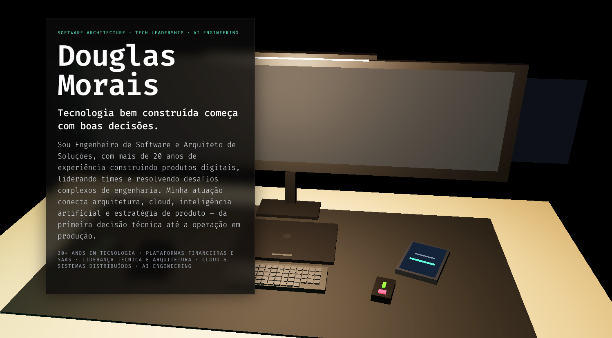

<!--
  Douglas Morais | GitHub Profile README
  Portfolio: https://douglasmorais-arq.vercel.app/
  Repository: github.com/mrdouglasmorais
-->

<div align="center">

<a href="https://douglasmorais-arq.vercel.app/" target="_blank">
  
</a>

<br/>

<a href="https://douglasmorais-arq.vercel.app/" target="_blank">
  
</a>
<a href="https://www.linkedin.com/in/douglasmoraissouza/" target="_blank">
  
</a>
<a href="mailto:mr.douglasmorais23@gmail.com">
  
</a>
<a href="https://github.com/mrdouglasmorais?tab=repositories">
  
</a>

<br/><br/>

[](https://douglasmorais-arq.vercel.app/)
[](https://github.com/mrdouglasmorais)

</div>

---

> [!TIP]
> **A prova está no código.** Quem contrata pode auditar. Atuo como consultor especialista e arquiteto de soluções para empresas que precisam de sistemas resilientes, arquitetura escalável e IA que realmente opera em produção sem alucinar regras de negócio. Conheça meu trabalho completo em **[douglasmorais-arq.vercel.app](https://douglasmorais-arq.vercel.app/)** ou vamos conversar pelo **[LinkedIn](https://www.linkedin.com/in/douglasmoraissouza/)**.

---

## 🏆 Reconhecimento, Certificações & Badges

Badges oficiais e certificações acadêmicas e de indústria conquistadas ao longo da trajetória:

### 🎓 Harvard, Stanford & Linux Foundation

<table align="center" width="100%">
  <tr align="center">
    <td width="20%" valign="top">
      <a href="https://douglasmorais-arq.vercel.app/certificates/courses/CS50x.pdf" target="_blank">
        <br/>
        <sub><b>Harvard University</b><br/>CS50x Computer Science</sub>
      </a>
    </td>
    <td width="20%" valign="top">
      <br/>
      <sub><b>Stanford University</b><br/>CS193p iOS Applications</sub>
    </td>
    <td width="20%" valign="top">
      <a href="https://douglasmorais-arq.vercel.app/certificates/courses/LFD121.pdf" target="_blank">
        <br/>
        <sub><b>Linux Foundation</b><br/>LFD121 Developing Secure Software</sub>
      </a>
    </td>
    <td width="20%" valign="top">
      <br/>
      <sub><b>Linux Foundation</b><br/>LFEL1006 OpenSSF Scorecard</sub>
    </td>
    <td width="20%" valign="top">
      <a href="https://douglasmorais-arq.vercel.app/certificates/courses/LFEL1008.pdf" target="_blank">
        <br/>
        <sub><b>Linux Foundation</b><br/>LFEL1008 Migrating AI Workflows</sub>
      </a>
    </td>
  </tr>
  <tr align="center">
    <td width="20%" valign="top">
      <a href="https://douglasmorais-arq.vercel.app/certificates/courses/LFS140.pdf" target="_blank">
        <br/>
        <sub><b>Linux Foundation</b><br/>LFS140 Feature Flagging (OpenFeature)</sub>
      </a>
    </td>
    <td width="20%" valign="top">
      <a href="https://douglasmorais-arq.vercel.app/certificates/courses/LFS144.pdf" target="_blank">
        <br/>
        <sub><b>Linux Foundation</b><br/>LFS144 Intro to Istio Service Mesh</sub>
      </a>
    </td>
    <td width="20%" valign="top">
      <a href="https://douglasmorais-arq.vercel.app/certificates/courses/LFS148.pdf" target="_blank">
        <br/>
        <sub><b>Linux Foundation</b><br/>LFS148 OpenTelemetry Observability</sub>
      </a>
    </td>
    <td width="20%" valign="top">
      <a href="https://douglasmorais-arq.vercel.app/certificates/courses/LFS158.pdf" target="_blank">
        <br/>
        <sub><b>Linux Foundation</b><br/>LFS158 Intro to Kubernetes</sub>
      </a>
    </td>
    <td width="20%" valign="top">
      <a href="https://douglasmorais-arq.vercel.app/" target="_blank">
        <br/>
        <sub><b>Cloud Native & Security</b><br/>Open Standards & Architecture</sub>
      </a>
    </td>
  </tr>
</table>

### 🎖️ Premiação & Imprensa

<table align="center" width="70%">
  <tr align="center">
    <td width="50%" valign="top">
      <a href="https://douglasmorais-arq.vercel.app/certificates/awards/50_to_Follow_2022_HACKER.pdf" target="_blank">
        <br/>
        <sub><b>Gama Academy — Award</b><br/>50 to Follow 2022 · Categoria Hacker</sub>
      </a>
    </td>
    <td width="50%" valign="top">
      <a href="https://douglasmorais-arq.vercel.app/certificates/press/sucesso-sa.pdf" target="_blank">
        <br/>
        <sub><b>Revista Sucesso SA — Imprensa</b><br/>Empreendedorismo, Liderança e Negócios</sub>
      </a>
    </td>
  </tr>
</table>

---

## 🧭 Do problema até quem usa

Quatro passos. Um sistema operável, resiliente e escalável:

```
┌──────────────┐     ┌──────────────┐     ┌──────────────┐     ┌──────────────┐
│   01. Foco   │ ──> │02. Estrutura │ ──> │03. Plataforma│ ──> │04. Utilização│
│   PROBLEMA   │     │ ARQUITETURA  │     │     AWS      │     │ EXPERIÊNCIA  │
│  O que deve  │     │  Serviços,   │     │  Entrega,    │     │  A tela ou   │
│  funcionar   │     │dados, limites│     │  telemetria  │     │   o agente   │
└──────────────┘     └──────────────┘     └──────────────┘     └──────────────┘
```

| Etapa | Foco de Decisão | Entrega de Valor |
|---|---|---|
| **01. Problema** | Domínio do negócio, requisitos de negócio e trade-offs técnicos | Clareza antes da primeira linha de código |
| **02. Arquitetura** | Clean Architecture, DDD, isolamento de fronteiras, idempotência e mensageria | Sistemas desacoplados que toleram falhas |
| **03. Plataforma** | Cloud AWS, Kubernetes (EKS), Serverless, Terraform e Observabilidade | Infraestrutura como código com FinOps e telemetria |
| **04. Experiência** | Interfaces reativas (Next.js/React), mobile (Flutter) ou Agentes Autônomos (MCP) | A ponta da entrega — visual ou orquestrada por IA |

---

## 🧠 Onde a IA entra: O modelo não segura o sistema. A arquitetura segura.

> Chamadas probabilísticas de modelos de linguagem precisam ficar **completamente isoladas** das regras determinísticas de negócio. É assim que a IA gera valor real sem colocar em risco a conformidade financeira, fiscal ou de domínio.

```text
                 ┌──────────────────────────────────────────────┐
                 │          User / Client / Web / Mobile        │
                 └──────────────────────┬───────────────────────┘
                                        │
                 ┌──────────────────────▼───────────────────────┐
                 │            API / Domain Gateway              │
                 │   Deterministic Business Rules, Auth & RBAC  │
                 └──────────────────────┬───────────────────────┘
                                        │
                 ┌──────────────────────▼───────────────────────┐
                 │           AI Orchestration Layer             │
                 │   Telemetry Context · Guardrails · MCP Tools │
                 └──────────────┬────────────────┬──────────────┘
                                │                │
              ┌─────────────────▼────┐    ┌──────▼───────────────────────┐
              │ Knowledge & Search   │    │  LLM Providers (Bedrock/etc) │
              │ RAG · Embeddings     │    │  Synthesizes only at the end │
              └──────────────────────┘    └──────────────────────────────┘
```

- **Além do RAG:** Evidência, versão e controle de permissão. A resposta só é emitida se o sistema audita e comprova de onde veio o dado.
- **SignalGate & Telemetria:** Telemetria vira contexto operacional. Jev/Orquestrador decide a rota e valida a evidência; o código executa. A IA não aperta o botão às cegas.
- **Agentes em Produção:** Embeddings e busca vetorial encontram o contexto exato. Roteamento de agentes especialistas com controle estrito de latência e consumo de tokens. O LLM escreve só no final.

---

## 🛠️ Stack Tecnológico & Arsenal de Engenharia

<div align="center">

### Linguagens, Frameworks & Frontend


### Cloud, Infraestrutura, DevOps & Dados


</div>

| Camada | Tecnologias & Padrões |
|---|---|
| **Arquitetura & Engenharia** | Clean Architecture, Domain-Driven Design (DDD), CQRS, Event-Driven, Microservices, C4 Model |
| **Backend & APIs** | C# .NET 9, Node.js, TypeScript, Python, GraphQL, REST APIs, gRPC, Outbox Pattern |
| **Cloud & DevOps (AWS)** | AWS Lambda, ECS / Fargate, EKS (Kubernetes), EventBridge, S3, Terraform, CI/CD Actions |
| **Inteligência Artificial** | Model Context Protocol (MCP), Amazon Bedrock, RAG, Embeddings, Multi-Agent Systems, Guardrails |
| **Bancos de Dados & Caching** | PostgreSQL, DynamoDB, SQL Server, Redis, OpenSearch, PgVector |
| **Frontend & Mobile** | React, Next.js (App Router), TypeScript, Tailwind CSS, Flutter, React Three Fiber (3D) |
| **Observabilidade & Métricas** | OpenTelemetry (OTel), Datadog, DORA Metrics, Tracing Distribuído, SonarQube |

---

## 🚀 Projetos & Soluções em Destaque

### 🏢 Habitvs — PropTech SaaS & Ecossistema de IA
*Idealização do produto e desenho da solução de ponta a ponta.*
- **Arquitetura:** Portal web, app mobile em Flutter, automação WhatsApp, ERP e pipeline de oportunidades imobiliárias integradas.
- **IA Integrada:** Plataforma aberta via **MCP (Model Context Protocol)** para operação de agentes de inteligência artificial.
- **Stack:** .NET 9, GraphQL, Next.js, Flutter, AWS, Docker, EKS e Terraform.

### 📈 AssetMind AI — Plataforma Multiagente para Mercado Financeiro
*Orquestração autônoma com controle determinístico de risco.*
- **Engenharia:** Agentes especialistas em ações, criptoativos e FIIs que operam sob cálculo de evidências.
- **Otimização:** Controle estrito de orçamento de tokens, telemetria de chamadas e síntese final via LLM.

### 🏙️ Garden Park Home Club — Experiência 3D Imersiva
*Jornada digital e interativa pelo empreendimento imobiliário em Balneário Camboriú.*
- **Engenharia:** Obra, fachada, projeção solar e planta humanizada navegável — do render 3D ao detalhe da unidade.
- **Stack:** Next.js · React Three Fiber · Three.js · Framer Motion.

### 💳 EmanaPay — Natura &Co
*Serviços financeiros digitais de alta confiabilidade.*
- **Engenharia:** Arquitetura Serverless com AWS Lambda, EventBridge, DynamoDB e mensageria de alta vazão para transações financeiras.
- **Confiabilidade:** Observabilidade ponta a ponta com Datadog e rastreamento distribuído.

### 🍺 Stella Signature — AB InBev
*E-commerce internacional de luxo.*
- **Engenharia:** Frontend moderno em React integrado a headless Drupal e Shopify para múltiplos mercados internacionais, com animações e microinterações fluidas.

---

## 🏢 Empresas e Marcas com as quais Colaborei

Empresas onde liderei projetos, atuei como consultor especialista, ensinei ou mentorei:

<div align="center">
  <p align="center">
    <b>Natura &Co</b> · <b>AB InBev</b> · <b>Record TV</b> · <b>Hospital Albert Einstein</b> · <b>Itaú</b> · <b>Méliuz</b><br/>
    <b>Kellogg's</b> · <b>iCarros</b> · <b>ABStartups</b> · <b>Magazine Luiza</b> · <b>Accenture</b> · <b>Avanade</b> · <b>Gama Academy</b> · <b>Biossance</b>
  </p>
</div>

---

## 📊 Estatísticas & Atividade no GitHub

<div align="center">

<a href="https://github.com/mrdouglasmorais">
  
  
</a>

<br/>


<br/><br/>

### 🐍 Histórico de Contribuições

<picture>
  <source media="(prefers-color-scheme: dark)" srcset="https://raw.githubusercontent.com/mrdouglasmorais/mrdouglasmorais/output/github-contribution-grid-snake-dark.gif" />
  <source media="(prefers-color-scheme: light)" srcset="https://raw.githubusercontent.com/mrdouglasmorais/mrdouglasmorais/output/github-contribution-grid-snake.gif" />
  
</picture>

</div>

---

<div align="center">

## 🤝 Vamos Conversar?

Seja para desenhar uma nova arquitetura do zero, destravar um gargalo crítico em sistemas distribuídos ou colocar IA para rodar em produção com segurança e governança:

<a href="https://douglasmorais-arq.vercel.app/" target="_blank">
  
</a>
<a href="https://www.linkedin.com/in/douglasmoraissouza/" target="_blank">
  
</a>
<a href="mailto:mr.douglasmorais23@gmail.com">
  
</a>

<br/><br/>

**Um café para a próxima decisão de arquitetura.**

<a href="https://www.buymeacoffee.com/douglasmorais23" target="_blank" rel="noopener">
  
</a>

<script type="text/javascript" src="https://cdnjs.buymeacoffee.com/1.0.0/button.prod.min.js" data-name="bmc-button" data-slug="douglasmorais23" data-color="#FFDD00" data-emoji=""  data-font="Cookie" data-text="Buy me a coffee" data-outline-color="#000000" data-font-color="#000000" data-coffee-color="#ffffff" ></script>

<br/><br/>

<a href="https://douglasmorais-arq.vercel.app/">
  
</a>

<br/><br/>


<br/><br/>

<a href="https://www.linkedin.com/in/douglasmoraissouza/">
  
</a>

<br/><br/>


</div>
